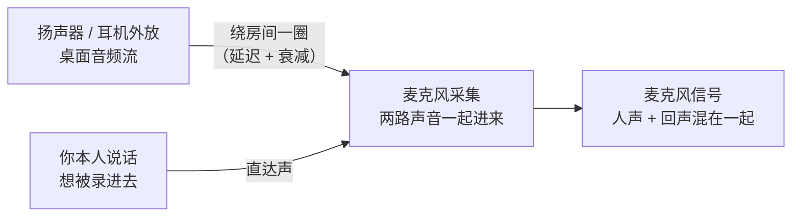
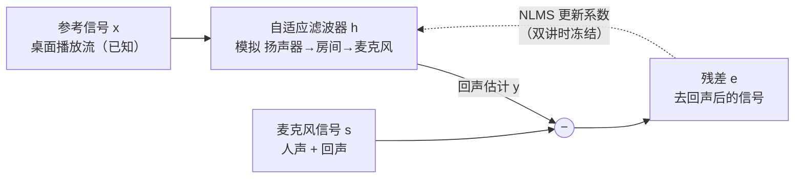
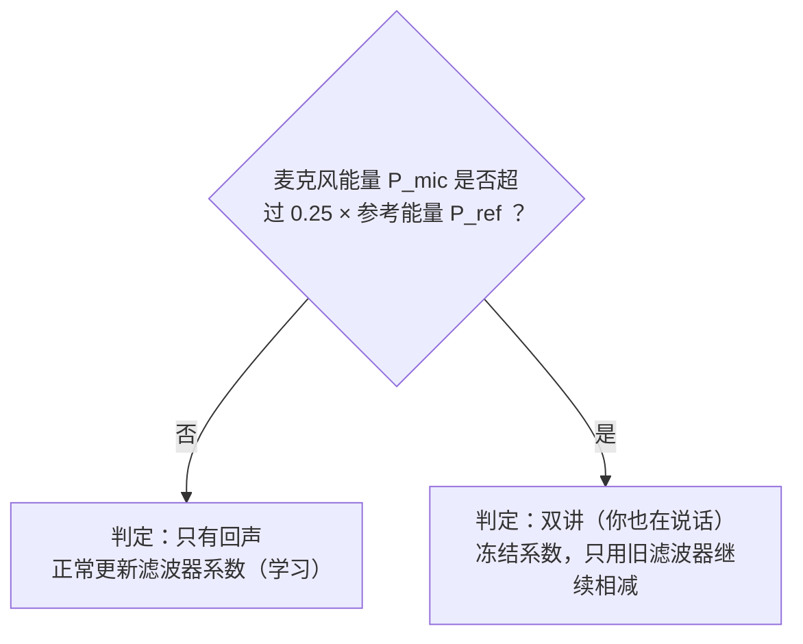

# 桌面音频录制（C++ 版）

独立的 Windows 桌面音频录制小工具：**WASAPI Loopback** 采集播放设备输出 → PCM16 →
**Media Foundation** 内置 MP3 编码器，输出到程序所在目录；可选同时录制**麦克风**并做
**回声消除（AEC）**。采集思路取自 OBS 的 `plugins/win-wasapi`，但不依赖 libobs / OBS 源码树，
直接用系统组件。

---

## 回声消除（AEC）实现说明

- 对应源码：[`src/echo_canceller.h`](src/echo_canceller.h) / [`src/echo_canceller.cpp`](src/echo_canceller.cpp)
- 接线位置：[`src/audio_mixer.cpp`](src/audio_mixer.cpp)
- 算法：**NLMS（归一化最小均方）自适应滤波** + **双讲检测（DTD）**

### 一句话概括

麦克风信号 = **你的人声** + **扬声器声音绕房间一圈漏进来的回声**。

程序用一条公式描述回声：

```
回声 ≈ h ⊛ 参考信号
```

其中 `⊛` 是**卷积**——把参考信号按不同延迟、不同音量叠加起来；`h`（一组权重，称为
**抽头 / taps**）就是那个我们不知道的"扬声器 → 房间 → 麦克风"泄漏路径。
**算法做的事就是边录边猜 `h`，猜准了就把回声从麦克风里减掉。**

### 回声是怎么进来的



录出来的文件里，对方的声音会被自己的麦克风再录一遍，听起来就是"回音"。

**为什么这个项目好办**：程序本来就要录桌面声音，所以"扬声器放出来的是什么"它是
**完全知道**的（loopback 直接抓的原始数据）。有了这个已知参考信号，回声就从"猜谜"
变成了一道可解的方程。

### 核心框图



---

### 代码逐段解读

#### 1. `Configure()` — 准备好滤波器

```cpp
m_w   = sampleRate * tailMs / 1000;         // 48000 × 100/1000 = 4800 个抽头
m_eps = m_w * 100.0;                        // 能量门限，见下面第 3 点
m_k   = 1.0 - exp(-1.0 / (sampleRate * 0.05));  // 约 50ms 时间常数
m_refCap = sampleRate / 4;                  // 参考 FIFO 上限，250ms
```

- `m_w = 4800`：滤波器能模仿**最长 100 毫秒**的回声。绝大多数房间的"直达声 + 早期反射"
  都落在这个范围内。
- 实际生效的步长 `μ` 是 **0.1**（头文件里的默认参数；成员初始值 `0.25f` 会被 `Configure`
  覆盖，是个不会生效的死默认值）。

#### 2. `PushReference()` — 桌面流先排队

```cpp
x = (l + r) * 0.5f;                                         // 立体声混成单声道
m_refFifo.push_back(x);
while (m_refFifo.size() > m_refCap) m_refFifo.pop_front();  // 时钟漂移兜底
```

**为什么需要这个 FIFO**：回声消除的隐含前提是"参考样本与麦克风样本一一对应"。但桌面流和
麦克风是两个独立设备、两条线程，到达节奏并不一致，所以先入队，处理麦克风时再逐个取出。
两个设备的时钟漂移靠 FIFO 上限兜底——参考流跑得太快时丢掉最旧的数据。

#### 3. `Process()` — 主循环，逐样本处理

按执行顺序拆成 6 步：

| 步骤 | 代码 | 作用 |
|---|---|---|
| ① 取参考 | `x = m_refFifo.front(); pop_front();` | 1:1 消费；FIFO 空了 `x = 0`（等于没有回声） |
| ② 维护能量 | `m_norm += x*x - old*old;` | 增量算出窗口内参考能量，避免每次重算 4800 次 |
| ③ 能量门控 | `if (m_norm <= m_eps*1.01) continue;` | 没有播放声音 → **直接直通**，不花任何 CPU |
| ④ 双讲检测 | 见下方 §5 | 判断你是否也在说话 |
| ⑤ 算回声 | `y += h[i] * m_win[ri];` | 这就是"卷积"，得到回声估计 |
| ⑥ 相减 + 学习 | `e = s - y;` 再更新 `h` | 输出残差，并用残差反过来修正 `h` |

**第 ⑤⑥ 步的数学**（NLMS = 归一化最小均方）：

```
e = s − h·x                      ← 残差：去掉回声后的信号，也就是最终输出
h ← h + μ · e · x / (‖x‖² + ε)   ← 系数更新
```

- **直观理解**：如果残差 `e` 仍为正，说明"我们低估了回声"，就把 `h` 往大调一点；反之调小。
  调多少由 `x` 决定——哪一段参考声音该为当前残差负责。
- **"归一化"的含义**：分母 `‖x‖²`（代码里就是 `m_norm`）做了能量归一。这样无论参考信号
  大声还是小声，学习速度都稳定，不会因为音量突变而"学飞"。

**环形缓冲为什么写得这么绕**：`m_win` 是循环数组，`m_pos` 既是"下一个要写的位置"，也是
"当前最旧样本的位置"。从 `m_pos` 开始顺着绕一圈，取到的正好是从旧到新排列的参考样本，
与 `h[0..m_w-1]` 一一对应。这样做是为了**不搬移内存**——否则每来一个样本都要挪动 4800 个数。

#### 4. 它是如何"判断"回声的

**先纠正一个前提：它不做"判断"**

代码里**没有任何一行**在做"这段信号是回声吗？"这类判定——没有分帧、没有特征提取、没有分类器。

原因是实时约束：每个采样点的预算只有 1/48000 秒（约 20 微秒）；更根本的是，**回声和人声在时间上是
重叠的**——你说话的同时扬声器也在响，两者糊在同一个采样点里，所以"按时间段切分"这条路从一开始
就走不通。

它实际做的是**预测—相减**。

**"回声"在代码里是一个性质，不是一个类别**

> 麦克风信号里，**能被参考信号线性预测出来**的那部分，就定义为回声。

```cpp
// 回声估计：y = h · x；环形缓冲满后 m_pos 处即最旧样本
float y = 0.f;
uint32_t ri = m_pos;
for (uint32_t i = 0; i < m_w; ++i)
{
    y += h[i] * m_win[ri];      // 用过去 100ms 的每一个参考采样点加权求和
    if (++ri == m_w) ri = 0;
}
```

注意 `m_win` 装的是参考信号**过去 4800 个采样点**（100ms 的历史），不是当前这一个点。所以完整的
含义是：

```
y[n] = Σ h[i] · x[n-i]        i = 0 .. 4799
       ↑        ↑
   4800 个权重  过去 100ms 的桌面声音
```

相当于在问：**"根据过去 100 毫秒桌面放出的声音，此刻麦克风里理应有多少声音？"**

**逐样本走一遍（带数字）**

把 4800 个抽头简化成 3 个，跟踪一个采样点：

| 步骤 | 计算 | 结果 |
|---|---|---|
| 窗口内的参考历史 | `m_win = [100, 0, 0]` | 参考在 2 拍前有个脉冲 |
| 真实房间增益 | 回声真值 `= 0.5 × 100` | **50** |
| ① 预测 | `y = 0×100 + 0×0 + 0×0` | **0**（`h` 还是全零） |
| ② 残差 | `e = s − y = 50 − 0` | **50**（完全没消掉） |
| ③ 学习 | `g = 0.1 × 50 / 10000 = 0.0005`<br>`h[0] += 0.0005 × 100` | `h = [0.05, 0, 0]` |

下一个同样的脉冲再进来时：`y = 0.05 × 100 = 5`，`e = 45`，`h[0]` 涨到 `0.095`……每步补上离真值
10% 的差距（`μ = 0.1`），最终 `h[0] → 0.5`、`e → 0`。

**"判断"其实藏在收敛结果里**：`h` 收敛的过程，本身就是"发现回声出现在延迟 = 2 拍、增益 = 0.5"
的过程。它不需要显式判断，收敛结果自带这个信息。

直观地看四路信号的时间轴：

```
时间 ─────────────────────────────────────────────────►

参考 x   ──────────|───────────────────────────────
麦克风 s ────────────|────~~~~~────────────~~~~~──────
预测 y   ────────────|──────────────────────────────
输出 e   ──────────────────~~~~~────────────~~~~~──────

         | = 回声脉冲（滞后于参考 → 能被预测 → 抵消）
         ~ = 人声（与参考无关 → 不可预测 → 保留）
```

**为什么只学回声、不学人声**

三道防线：

| 防线 | 机制 | 作用 |
|---|---|---|
| ① 数学本质 | 更新量 `g ∝ e · x` | 只有与参考相关的成分**能被**减掉 |
| ② 能量门控 | `if (m_norm <= m_eps * 1.01) continue;` | 安静时直通，避免被你的声音"带飞" |
| ③ 双讲冻结 | 见 §5 | `e` 里混着人声时停止学习 |

**① 是根本原因。** 学习目标是最小化 `e²`，而算法**唯一能调的旋钮就是 `h` 这 4800 个系数**。如果
麦克风里有一样东西根本不由 `x` 决定（人声就是），那么无论 `h` 怎么调都减不掉它的平方——优化
过程对它无能为力，它就原封不动地留在 `e` 里。从相关性看：人声 `v` 与 `x` 统计不相关时
`E[v·x] ≈ 0`，长期看它对 `h` 的更新贡献正负相互抵消。

**② 防的是一个经典事故**：安静时 `x` 全是 0，分母 `‖x‖²` 趋近 0，这时你一说话 `e` 很大 →
`g = μe/‖x‖²` 会爆炸 → `h` 被炸飞。`m_eps` 这个能量下限（以及公式里的 `+1e-9`）就是防它。

**学完之后：`h` 就是"房间的指纹"**

`h` 的下标 `i` 就是**延迟**（0 ~ 4799，对应 0 ~ 100ms）。学完之后：

- `h[0] ≈ 0`：极短延迟上没有能量
- `h[2400]` 有个峰：约 50ms 处有一路反射
- 整条曲线画出来就是**房间脉冲响应**（RIR）

也就是说，这个算法顺带把"你这个房间的声学特性"给测出来了。

**那输出 `e` 是"干净人声"吗？**

不是：

```
e = 人声 + (真实回声 − 预测回声)
            └──── 没消干净的残留 ────┘
```

- 残留不会为 0，只是收敛后变得很小。
- **反例**：如果你的人声恰好与参考相关（比如麦克风拾到了与参考同源的声音），那部分人声也会被
  当成"可预测"减掉，表现为声音发虚、断续。
- **线性假设之外**：扬声器音量过大产生的失真不是 `x` 的线性函数，被判为"不可预测"，当作
  "非回声"留在 `e` 里——这就是为什么这个实现消不掉非线性回声。

> **一句话总结**：它从不判断"这段是回声"。它只回答一个问题——*根据过去 100ms 桌面放出的声音，
> 此刻麦克风里应该有多少声音？* 算出来减掉，剩下的就是输出。**"回声"只是"可被参考预测"的
> 另一个名字。**

#### 5. 双讲检测（DTD）

```cpp
m_pMic += (s0 * s0 - m_pMic) * m_k;   // 指数平滑后的麦克风功率
m_pRef += (x  * x  - m_pRef) * m_k;   // 指数平滑后的参考功率
if (m_pMic > m_dtdRatio * m_pRef) m_hold = m_holdMax;  // 判定双讲，挂起 150ms
const bool freeze = m_hold > 0;
```



**为什么需要它**：NLMS 的假设是"残差 `e` 全部来自回声估计不准"。但你一说话，`e` 里就混进了
**你的人声**——算法会误以为"`h` 猜错了"，然后朝错误方向疯狂修正，把已经学好的 `h` 带偏
（术语叫 *divergence*，发散）。

所以检测到双讲时**冻结系数更新**，只保留"用已收敛的 `h` 做相减"这件事。`m_hold` 的 150ms
挂起用于防抖——避免你刚停顿一下就立刻解除冻结。

> 阈值 `m_dtdRatio = 0.25` 是一个先验：回声是参考信号**衰减**后的产物，正常情况下麦克风能量
> 不可能反过来大幅超过参考能量；一旦超过，就说明麦克风里有别的东西——也就是你在说话。

#### 6. 在管线中的位置（`audio_mixer.cpp`）

```cpp
// PushDesktop()：桌面流一边输出，一边喂给 AEC 当参考
if (m_aecOn) m_aec.PushReference(data, frames, m_channels);

// PushMic()：重采样到统一速率 → 去回声 → 映射声道 → 相加
if (m_aecOn && rsFrames > 0) m_aec.Process(rsData, rsFrames);
```

**顺序很关键**：必须"先推参考、后处理麦克风"。因为 `Process` 是按先进先出逐个消费参考样本的，
参考还没入队就会读到 0。

---

### 设计取舍与局限

| 设计 | 代价 |
|---|---|
| 立体声参考被混成单声道 | 左右声道回声不同时会有残留，外放场景消不干净 |
| 线性 FIR 滤波器 | 只能模拟线性声学路径；扬声器音量过大导致的**非线性失真**消不掉 |
| 回声窗口固定 100ms | 大房间 / 长混响不够用；调大则 CPU 开销线性上升 |
| 固定门限 0.25 做 DTD | 简单高效，但阈值是经验值；不如双滤波器 / 归一化互相关稳健 |
| 没有残余回声抑制（RES）后处理 | 收敛不完全时，残留回声会直接留在录音里 |
| 关闭麦克风或关闭 AEC 时 | 零开销直通——这是刻意的设计 |

**总的来说**：这是一个**极小体积、能自洽工作**的 NLMS-AEC，约 140 行覆盖了
"参考对齐 + 能量门控 + 双讲冻结 + 环形窗口卷积"。它不做高级的频域分块，也不做非线性残留
抑制，但在"桌面外放 + 会议语音"这种信噪比尚可的场景里足够用。

> Rust 版移植（[`src_rs/`](src_rs)）保持了逐样本的算法等价，见
> [`src_rs/README.md`](src_rs/README.md)。
